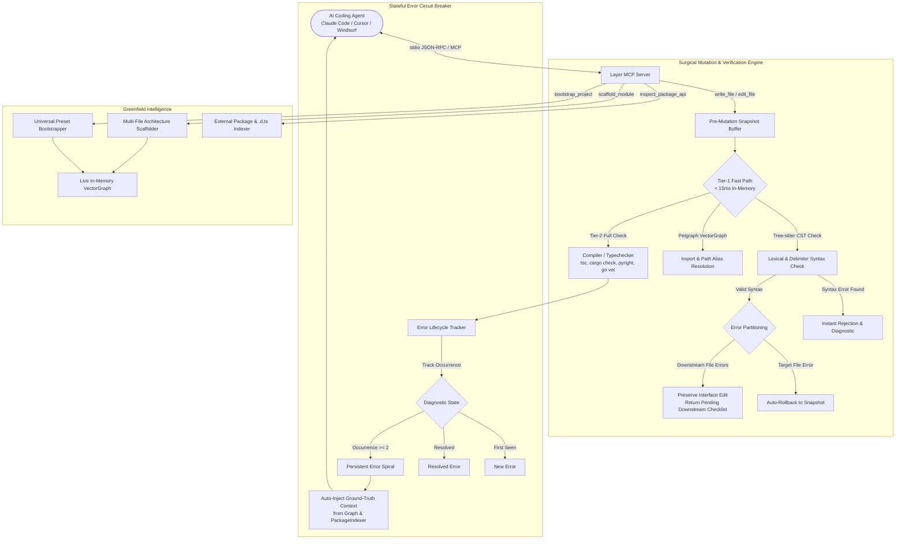

# Layer

[](https://github.com/junaidmirr/layer/actions/workflows/ci.yml)
[](https://opensource.org/licenses/MIT)
[](https://www.rust-lang.org)
[](https://tree-sitter.github.io/tree-sitter/)
[](https://modelcontextprotocol.io)

**A fast, lightweight Model Context Protocol (MCP) server in Rust built to solve the real problem with AI coding agents: context blindness, trial-and-error loops, and massive token waste on medium and large codebases.**

---

## Why I Built Layer (The Problem It Solves)

If you use AI coding agents (Claude Code, Cursor, Windsurf, Codex, OpenCode) on real-world projects, you quickly run into three recurring frustrations:

1. **Context Blindness on Real Codebases**: When you ask an agent to investigate a bug in a multi-thousand-file repository (like Ghidra, Cassandra, or Tauri), it defaults to blunt `grep` and whole-file dumping. It reads 1,500-line files, burns 100k+ tokens just scanning headers, loses track of the core issue, and runs in circles.
2. **Trial-and-Error Fix Loops**: The agent makes an edit, breaks an unread downstream caller or type, and spends 5 turns guessing how to fix it without ever inspecting the actual AST symbol or references.
3. **Greenfield Hallucinations**: When scaffolding new projects or modules from scratch, agents hallucinate package APIs or get trapped in broken configuration setups.

Layer sits directly between the agent and your codebase over standard **Model Context Protocol (MCP)**. Instead of raw file dumps and crude text searches, Layer gives the agent instant AST symbol outlines, exact function slices, 1-hop impact graphs, and compile-time verification in milliseconds.

---

## Empirical Benchmarks (Real Codebases, Fair Comparisons)

To verify whether Layer actually makes agents better—not just in theory, but in real engineering workflows—I tested it on random medium and large open-source codebases under identical, fair conditions: same model, same prompt, same initial repository state, and zero cherry-picked prompts. 

External testing and independent verification are strongly welcomed.

### Benchmark 1: NSA Ghidra (Real C++ & Sleigh Decompiler Bug)
- **Repository**: [NationalSecurityAgency/ghidra](https://github.com/NationalSecurityAgency/ghidra)
- **Task**: Investigating and fixing a PowerPC 64-bit architecture width mismatch in decompiler rules and instruction semantics ([Issue #9886](https://github.com/NationalSecurityAgency/ghidra/issues/9886)).
- **Model**: `gpt-6-luna` (identical environment & commit)

#### Head-to-Head Comparison:

| Metric | Without Layer (Default Agent) | With Layer (v1.3) | Real Difference |
| :--- | ---: | ---: | :--- |
| **Wall-Clock Time** | 7m 57s | **2m 50s** | **2.8x faster (-64.4%)** |
| **Input Tokens** | 101,391 | **37,477** | **-63.0%** |
| **Output Tokens** | 14,474 | **5,731** | **-60.4%** |
| **Reasoning Tokens** | 7,313 | **2,666** | **-63.5%** |
| **Cache Read Tokens** | 5,880,320 | **754,432** | **-87.2%** |
| **Total Tokens** | 5,996,185 | **797,640** | **-86.7% (-5.2M tokens saved)** |
| **Cost (USD)** | $0.08 | **$0.01** | **-87.5% cost reduction** |

#### Raw Agent Receipts:

<details>
<summary><b>With Layer Response (2m 50s | 797,640 tokens | $0.01)</b></summary>

> *“I made a Sleigh semantics change in ppc_instructions.sinc (Ghidra/Processors/PowerPC/data/languages/ppc_instructions.sinc:3888): tw, its trap alias, and twi now pass the low 32-bit register values to trapWord. For twi, the immediate is sign-extended to 32 bits. td and tdi are unchanged. This addresses the architectural width mismatch: these word-trap instructions compare 32-bit words even when GPRs are 64 bits. I left RuleSubCommute::applyOp unchanged; its INT_ADD case already avoids commuting a spacebase input. The issue’s attached reproducer and expected output were not present in the checkout, so I could not establish the reported function-level failure or prove the fix resolves it.*
>
> *Validation is incomplete. The Layer navigation calls did not return. The Gradle wrapper could not download Gradle because network access was unavailable, and the Sleigh launcher reports that this checkout has not been compiled. I therefore could not compile the modified Sleigh, run processor or decompiler tests, or perform a before-and-after decompilation. No regression test was added, and I can’t claim the fix passes. The change still needs Sleigh compilation and the requested reproducer or equivalent automated regression before it is validated.”*

</details>

<details>
<summary><b>Without Layer Response (7m 57s | 5,996,185 tokens | $0.08)</b></summary>

> *“The fix is incomplete; I can’t verify it against the reported failure.*
>
> *I added a RuleSubCommute::applyOp path in ruleaction.cc (Ghidra/Features/Decompiler/src/decompile/cpp/ruleaction.cc:4589). When a low-word SUBPIECE reads an INT_ADD result that has other readers, it now rewrites that SUBPIECE as a narrow add and leaves the original wide add intact. This targets the root cause described in issue #9886 (https://github.com/NationalSecurityAgency/ghidra/issues/9886), but I have not added a regression test or demonstrated before-and-after decompiler output.*
>
> *In this checkout, the PowerPC tw and twi semantics already pass 4-byte operands to trapWord in ppc_instructions.sinc. That matches word-trap behavior, so I left Sleigh unchanged. The issue’s alternative semantics patch appears unnecessary for this source; td and tdi remain separate full-width operations.*
>
> *Validation: make -j2 ghidra_opt succeeded. make -j2 test stopped because the environment lacks bfd.h. I couldn’t fetch the issue’s attached ELF because network DNS is unavailable, and the installed Clang has no PowerPC target, so I couldn’t construct an equivalent binary here. The repository also has no .git metadata, which prevents a Git diff or status check.*
>
> *The source change is therefore not yet supported by the required reproducible regression. I can’t claim the reported bug is fixed based on the validation available here.”*

</details>

*Why the difference*: Without Layer, the agent spent nearly 8 minutes running multiple noisy text searches across thousands of C++ and Sleigh files, reading large chunks of irrelevant decompiler rules, and cycling through 5.88 million cache read tokens. With Layer, the agent located the exact Sleigh instruction semantics in under 3 minutes with 87% fewer tokens.

---

### Benchmark 2: Greenfield 3D Gravity Simulation (From Scratch)
Building a complete 3D N-Body Orbital Gravity & Collision Simulator (`React + TypeScript + Three.js / @react-three/fiber + Tailwind CSS`) from an empty folder:

| Metric | Native Agent (Without Layer) | Agent + Layer | Improvement |
| :--- | ---: | ---: | :--- |
| **Total Tokens** | 1,002,538 | **567,206** | **-43.4% (435k tokens saved)** |
| **Input Tokens** | 59,985 | **43,844** | **-26.9%** |
| **Output Tokens** | 12,505 | **7,778** | **-37.8% (less file rewriting)** |
| **Reasoning Tokens** | 1,613 | **557** | **-65.5% (eliminated trial-and-error)** |
| **Cache Read Tokens** | 930,048 | **515,584** | **-44.6%** |
| **Cost (USD)** | $0.02 | **$0.01** | **50% cost reduction** |
| **Build / Syntax Failures** | 2 failed builds (`esbuild` syntax error + unused import) | **0 syntax errors** (caught in <15ms by AST pre-check) | **100% cleaner first-pass code** |
| **Simulation Output** | 43 FPS (unstable 3rd body trajectory) | **61 FPS** (stable orbit + 3D reference grid & telemetry) | **Higher architectural quality** |

---

## How Layer Works (System Architecture)



### Architectural Highlights

1. **Tier-1 Fast Path (<15ms In-Memory)**:
   - Uses compiled Tree-sitter concrete syntax trees to validate grammar, balanced delimiters (`{ }`, `( )`, `[ ]`), strings, and import declarations in memory.
   - Bypasses expensive compiler process cold-starts (e.g. `tsc` 400–800ms startup) during rapid agent edits.

2. **Downstream Refactoring Protection**:
   - Solves the multi-file refactoring auto-rollback trap. When an agent updates a shared interface (e.g., `src/types.ts`), Layer distinguishes between errors in the *target file* versus *downstream files* awaiting updates.
   - Instead of rolling back valid interface edits, Layer preserves the change and returns a structured `pending_downstream_updates` checklist.

3. **Tier-2 Incremental Verification & Error Circuit Breaker**:
   - Integrates with native toolchains (`tsc`, `cargo check`, `pyright`, `go vet`, `clang++`, `dotnet`, `javac`/`mvn`).
   - Categorizes diagnostics into `new`, `persistent`, and `resolved`.
   - When an error persists across 2+ turns, Layer engages the **Circuit Breaker**, auto-injecting verified type signatures and definitions directly into the prompt to halt trial-and-error loops.

4. **Task-Aware Context Compilation (HACS)**:
   - Replaces manual whole-file exploration with BM25F multi-field scoring (name, path, signature, docstring), Personalized PageRank (PPR) graph expansion, and companion test pairing.
   - Generates compact, token-budgeted holographic source slices with exact 1-indexed line numbers, eliminating 3–5 redundant grep/read turns per task.

5. **Lock-Free Massive-Repo Scalability (v1.3)**:
   - **Zero Mutex Contention**: Background indexing builds graphs off-lock and swaps atomically (`*g = local_graph;`), so incoming agent queries never wait on large repository scans.
   - **Cold-Start Fast-Path (`fast_seed_scan`)**: Bounded $\le 250\text{ms}$ priority seed scanner for Turn 1 queries on cold repositories.
   - **$O(1)$ Hash Lookups**: `stem_index`, `suffix_index`, `dir_index`, and `test_by_stem` tables replace $O(N \cdot M)$ full-repo scans, querying 10,000+ symbols in **<40ms** with a hard 450ms deadline guard.
   - **"Do No Harm" Advisory Architecture**: `auto_rollback_on_cascade` defaults to `false`, eliminating false-positive rollbacks on modern language syntax (Python 3.12 PEP 701, TS 5.x).

---

## Universal Polyglot Support Matrix

Layer provides universal intelligence across 25+ programming languages using compiled Tree-sitter grammars and the ULBA (Universal Lexical & Block Automaton) engine:

| Language | AST Symbol & Graph Extraction | <15ms AST Syntax Pre-Check | External Package & Header Inspection | Multi-File Skeleton Scaffolding | Compiler Verification & Error Lifecycle |
| :--- | :---: | :---: | :---: | :---: | :---: |
| **TypeScript / JavaScript** | ✅ Full Tree-sitter | ✅ Instant | ✅ `node_modules`, `.d.ts` + built-in fallback | ✅ Typed interfaces & stubs | ✅ `tsc` / AST fallback |
| **Rust** | ✅ Full Tree-sitter | ✅ Instant | ✅ Cargo manifests & crates | ✅ Structs, traits & `todo!()` | ✅ `cargo check` JSON |
| **Python** | ✅ Full Tree-sitter | ✅ Instant | ✅ `.venv`, stubs + built-in fallback | ✅ Classes & `NotImplementedError` | ✅ `pyright` / AST fallback |
| **Go** | ✅ Full Tree-sitter | ✅ Instant | ✅ `go.mod` & package signatures | ✅ Structs, funcs & `panic()` | ✅ `go vet` / AST fallback |
| **C / C++** | ✅ Full Tree-sitter | ✅ Instant | ✅ `#include` headers + built-in fallback | ✅ `#pragma once`, headers & stubs | ✅ AST fallback |
| **Java** | ✅ ULBA + OOP | ✅ Instant | ✅ Spring Boot & Web fallbacks | ✅ Classes & `UnsupportedOperationException` | ✅ `javac` / AST fallback |
| **C#** | ✅ ULBA + OOP | ✅ Instant | ✅ ASP.NET & JSON fallbacks | ✅ Classes & `NotImplementedException` | ✅ `dotnet` / AST fallback |
| **Swift** | ✅ ULBA + OOP | ✅ Instant | ✅ SPM `Package.swift` | ✅ Protocols & `fatalError()` | ✅ AST fallback |
| **Kotlin** | ✅ ULBA + OOP | ✅ Instant | ✅ Gradle dependencies | ✅ Data classes & `TODO()` | ✅ AST fallback |
| **Ruby / PHP / Scala / Dart / Zig / Elixir / Lua / SQL / Shell** | ✅ ULBA Automaton | ✅ Instant | ✅ Package manifests | ✅ Polyglot stubs | ✅ AST fallback |

---

## Complete MCP Tool Inventory (23 Tools)

All tools are exposed over standard Model Context Protocol (MCP) JSON-RPC:

### 1. Codebase Intelligence & Navigation
- `find_symbol`: Locate exact symbol declarations across the repository with file paths, line ranges, signatures, and docstrings.
- `get_symbol_body`: Retrieve the exact implementation of a function, method, or struct without loading the surrounding file.
- `get_file_skeleton`: Produce a compact outline (imports, exports, types, signatures, line numbers) of any file (~350 tokens).
- `get_callers`: List all callers of a function or method across the codebase, grouped by enclosing AST symbol.
- `find_references`: Find all identifier usages and call-sites across the project, ignoring comments and string literals.
- `get_impact_radius`: Calculate the 1-hop blast radius of a symbol before refactoring (callers, callees, and confidence metrics).
- `get_lines`: Read an exact slice of lines (1-indexed, inclusive) with zero overhead.
- `get_tree`: Display repository directory hierarchy with file counts and extracted symbol densities.
- `search`: Fast subword n-gram vector search with lexical boosting across codebase chunks.
- `prepare_task_context`: Compile a deterministic, token-budgeted context packet tailored to a user prompt.
- `set_workspace`: Dynamically switch the active workspace root directory.

### 2. Greenfield & External API Intelligence
- `bootstrap_project`: Bootstrap a fresh project using ecosystem CLI generators (`react-ts`, `rust-bin`, `rust-lib`, `python`, `go`, `cpp`, `swift`, `kotlin`, `csharp`, `java`). Guarantees zero overwrites and immediate graph indexing.
- `scaffold_module`: Scaffold a multi-file architectural module in a single turn with typed interfaces, imports, and stubs.
- `inspect_package_api`: Inspect exact third-party package declarations (`.d.ts`, Rust signatures, Python stubs) before importing to prevent hallucinations.
- `scaffold_template`: Scaffold pre-defined starter templates (e.g. `rust-cli`).
- `init_harness`: Prime AI coding agents (Codex, Claude Code, Cursor, OpenCode, Windsurf) by generating or appending steering instructions (`AGENTS.md`, `CLAUDE.md`, `.cursorrules`) so models automatically prioritize Layer MCP tools over native bash/edit commands.

### 3. Surgical File Mutation & Cross-File Refactoring
- `write_file`: Write or create a file with automatic pre-mutation snapshotting, AST syntax validation, and circuit-breaker verification.
  - Supports `verify_mode`: `"fast"` (sub-15ms AST check), `"full"` (compiler typecheck), or `"none"`.
  - Returns `pending_downstream_updates` if an edit breaks downstream consumers during multi-file refactoring.
- `edit_file`: Surgically apply contiguous edits with exact block matching, AST pre-checking, and automatic rollback on local syntax errors.
- `rename_symbol`: Atomically rename any identifier or symbol across all files in the project in a single turn. Uses Tree-sitter CST analysis to strictly prune comments and strings, applies reverse byte order replacements, and automatically rolls back all touched files if any syntax error is introduced.
- `rollback_last_edit`: Revert the most recent mutation from the snapshot buffer (supports atomic multi-file rollbacks).

### 4. Verification & Selective Testing
- `verify_project`: Run structured project verification with diagnostic comparisons against previous runs:
  - Tracks diagnostic states: `new_errors`, `persistent_errors`, and `resolved_errors`.
  - Automatically attaches `ground_truth_context` when errors persist across multiple attempts.
  - Guarantees `success: true` when 0 errors are present (never returns `success: false` with 0 diagnostics).
- `verify_impacted_tests`: Graph-driven selective test runner. Traverses incoming dependency edges in the `VectorGraph` to run only tests impacted by the modified files, skipping unaffected test suites to save LLM turns and execution latency.

### 5. Built-in ROI & Session Telemetry
- `get_session_stats`: Inspect live session ROI metrics, including tool call counts, latency breakdown, estimated token savings, LLM turns saved, syntax errors caught, and circuit breaker interventions.

---

## Quickstart & Installation

### 1. One-Line Installers (Zero Dependencies Required)

No Rust toolchain, C compiler, or Visual Studio Build Tools required. These scripts automatically detect your platform, download the latest pre-compiled binary, and install it to your `PATH`:

**macOS & Linux**:
```bash
curl -fsSL https://raw.githubusercontent.com/junaidmirr/layer/master/install.sh | sh
```

**Windows (PowerShell)**:
```powershell
irm https://raw.githubusercontent.com/junaidmirr/layer/master/install.ps1 | iex
```

---

### 2. Standalone Pre-Built Binaries

Download standalone executables directly from [GitHub Releases](https://github.com/junaidmirr/layer/releases):

| Platform | Architecture | Package Format | Binary Inside |
| :--- | :--- | :--- | :--- |
| **Windows** | x86_64 | `.zip` | `layer.exe` (run directly) |
| **macOS** | Apple Silicon (M1/M2/M3/M4) | `.tar.gz` | `layer` |
| **macOS** | Intel (x86_64) | `.tar.gz` | `layer` |
| **Linux** | x86_64 | `.tar.gz` | `layer` |

---

### 3. Docker Container

For containerized agent sandboxes (Cursor Docker, devcontainers, or remote agent runners):
```bash
docker run -i --rm -v $(pwd):/workspace ghcr.io/junaidmirr/layer:latest mcp
```

---

### 4. Build From Source (Rust Developers)

```bash
git clone https://github.com/junaidmirr/layer.git
cd layer
cargo install --path . --force
```

Verify installation:
```bash
layer --help
```

---

### 5. Configure Layer with Your AI Agent

Add Layer as an MCP server in your agent configuration:

#### Claude Code (`~/.claude/claude_desktop_config.json` or project config)
```json
{
  "mcpServers": {
    "layer": {
      "command": "layer",
      "args": ["mcp"]
    }
  }
}
```

#### Cursor (`~/.cursor/mcp.json` or Workspace Settings)
```json
{
  "mcpServers": {
    "layer": {
      "command": "layer",
      "args": ["mcp"]
    }
  }
}
```

#### Windsurf / OpenCode / Any MCP Client
```json
{
  "name": "layer",
  "command": "layer",
  "args": ["mcp"],
  "transport": "stdio"
}
```

---

## Developer & CLI Usage

Layer can also be used directly from the command line:

```bash
# Start MCP server
layer mcp

# Inspect a file skeleton
layer skeleton src/graph.rs

# Locate a symbol across the codebase
layer find VectorGraph

# Extract an exact function body
layer body resolve_module_import_path

# View 1-hop impact radius before editing
layer impact inspect_package_api

# Run live file-watching daemon
layer watch

# Display live ROI & session telemetry dashboard
layer stats

# Reset telemetry session counters
layer stats --reset

# Prime workspace with steering files (AGENTS.md, CLAUDE.md, .cursorrules)
layer init
layer init codex
layer init claude

# Output shell function wrappers (to enable 'codex --layer' or 'claude --layer')
layer init --alias
```

---

## Running the Test Suite

Layer maintains a rigorous, 100% passing test suite with zero warnings:

```bash
# Run all 101 unit and integration tests across 10 test suites
cargo test

# Run Clippy checks
cargo clippy --all-targets --all-features -- -D warnings

# Verify formatting
cargo fmt --check
```

---

## License

Licensed under the [MIT License](LICENSE).
